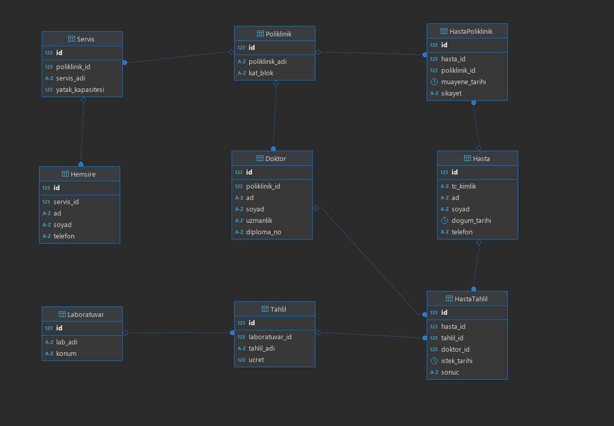

# 🏥 Hastane Otomasyonu Veritabanı Tasarımı (Ders Sonu Ödevi)


Bu çalışma; **Hasta**, **Doktor**, **Poliklinik**, **Laboratuvar**, **Tahlil**, **Hemşire** ve **Servis** varlık kümeleri arasındaki iş kurallarına göre modellenmiş Varlık-İlişki (ER) diyagramını ve ilişkisel veritabanı tablo tasarımlarını içermektedir.

---

## 👤 Öğrenci Bilgileri

| Ad Soyad | Öğrenci Numarası |
| :--- | :---: |
| **Muhammed Ege Atılgan** | `462268` |

---

## 🗄️ Veritabanı Mimarisi ve Tablo Grupları

Sistem toplam **9 tablodan** (7 ana varlık tablosu + 2 `N:M` kesişim/ara tablosu) oluşmakta olup, bağımlılık sırasına göre **3 ana grupta** modellenmiştir:

| Grup Sırası | Kategori | Tablolar | Açıklama |
| :---: | :--- | :--- | :--- |
| **1** | **Temel Tanım Tabloları** | `Poliklinik`, `Laboratuvar`, `Hasta` | Diğer tabloların referans aldığı bağımsız ana tablolar (`1` tarafındaki varlıklar). |
| **2** | **Bağımlı Tablolar (`1:N`)** | `Doktor`, `Servis`, `Hemsire`, `Tahlil` | Kural 1, 4, 5 ve 6 gereği `1:N` ilişkilerle temel tablolara `FOREIGN KEY` ile bağlanan tablolar. |
| **3** | **Ara / Kesişim Tabloları (`N:M`)** | `HastaPoliklinik`, `HastaTahlil` | Kural 2 ve 3'teki çoktan-çoğa (`N:M`) ilişkileri çözmek için oluşturulan ilişki tabloları. |

---

## 📋 İş Kuralları ve Tablo Karşılıkları

1. **Doktor – Poliklinik (`1:N`):** Bir poliklinikte birden fazla doktor çalışabilir, bir doktor birden fazla poliklinikte çalışamaz. (`Poliklinik.id` $\rightarrow$ `Doktor.poliklinik_id` **FK**)
2. **Hasta – Poliklinik (`N:M`):** Hastalar poliklinikte muayene olur. Çoktan-çoğa ilişki olduğu için **`HastaPoliklinik`** ara tablosu oluşturulmuştur (`hasta_id` **FK**, `poliklinik_id` **FK**).
3. **Hasta – Tahlil – Doktor (`N:M`):** Hastalar tahlil yaptırabilir, tahlilleri doktorlar ister. Çoktan-çoğa ilişki olduğu için **`HastaTahlil`** ara tablosu oluşturulmuştur (`hasta_id` **FK**, `tahlil_id` **FK**, `doktor_id` **FK**).
4. **Tahlil – Laboratuvar (`1:N`):** Tahliller laboratuvarda yapılır, bir tahlil iki farklı laboratuvarda yapılmaz. (`Laboratuvar.id` $\rightarrow$ `Tahlil.laboratuvar_id` **FK**)
5. **Hemşire – Servis (`1:N`):** Bir serviste birden fazla hemşire olabilir, aynı hemşire iki farklı servise hizmet vermez. (`Servis.id` $\rightarrow$ `Hemsire.servis_id` **FK**)
6. **Servis – Poliklinik (`1:N`):** Servisler polikliniklere aittir. Bir polikliniğin birden fazla servisi olabilir. (`Poliklinik.id` $\rightarrow$ `Servis.poliklinik_id` **FK**)

---

## 📐 ER Diyagramı

Veritabanı tabloları arasındaki ilişkileri ve anahtar yapılarını gösteren varlık-ilişki (ER) diyagramı aşağıda yer almaktadır:



---

## 🚀 Kurulum

Veritabanı şeması `Data_base/01_schema.sql` altında yer almaktadır:

```sql
SOURCE Data_base/01_schema.sql;
```
