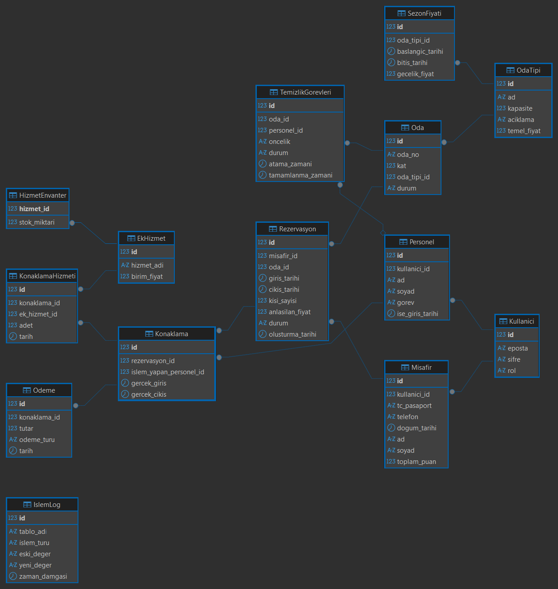

# 🏨 Otel Rezervasyon ve Konaklama Yönetim Sistemi


Bu proje; bir otelin **rezervasyon**, **konaklama**, **ek hizmet**, **temizlik** ve **ödeme** süreçlerini uçtan uca yöneten, veri bütünlüğü ve veritabanı mimarisi odaklı bir otomasyon sistemidir.

---

## 📋 İçindekiler

- [Proje Ekibi](#-proje-ekibi)
- [Teknoloji Yığını ve Mimari](#-teknoloji-yığını-ve-mimari)
- [Veritabanı Mimarisi](#-veritabanı-mimarisi)
- [ER Diyagramı](#-er-diyagramı)
- [Veritabanı Tetikleyicileri (Triggers)](#-veritabanı-tetikleyicileri-triggers)
- [Örnek Veri Seti (Mock Data) ve Test Laboratuvarı](#-örnek-veri-seti-mock-data-ve-test-laboratuvarı)
- [Kurulum ve Çalıştırma](#-kurulum-ve-çalıştırma)

---

## 👥 Proje Ekibi

| Ad Soyad | Öğrenci Numarası | Sorumluluk Alanı ve Görevler |
| :--- | :---: | :--- |
| **Muhammed Ege Atılgan** | `462268` | **Backend & Veritabanı:** Veritabanı şeması, Trigger, Stored Procedure, Spring Boot geliştirmeleri |
| **Ali Sergen Erol** | `466814` | **Frontend, Backend & QA:** React arayüzü, API testleri, dokümantasyon ve Spring Boot geliştirmeleri |

> [!NOTE]
> Proje geliştirme sürecinin ilerleyişine göre görev dağılımında güncellemeler yapılabilir.

---

## 🛠 Teknoloji Yığını ve Mimari

Sistem, sürdürülebilirlik ve ölçeklenebilirlik ilkeleri doğrultusunda **Katmanlı Mimari** (*Entity, Repository, Service, Controller*) yapısıyla tasarlanmıştır.

* **Veritabanı:** **MySQL 8** *(InnoDB depolama motoru; ACID uyumu, transaction desteği ve foreign key bütünlüğü için tercih edilmiştir)*
* **Backend:** **Spring Boot (Java 17)**, Spring Data JPA, Maven
* **Frontend:** **React** & **Tailwind CSS** *(Arayüz geliştirme sürecinde üretken yapay zeka araçlarından yararlanılmaktadır)*
* **Altyapı & Konteyner:** **Docker**
* **API Belgelendirme & Test:** **Swagger (OpenAPI)**, **Postman**
* **Versiyon Kontrol Yapılandırması:** Proje `.gitignore` ve ortam yapılandırma şablonları AI desteğiyle optimize edilmiştir.

---

## 🗄️ Veritabanı Mimarisi

Sistem toplam **15 tablodan** oluşmakta olup, tablo ilişkileri ve bağımlılık sırasına göre **5 ana grupta** modellenmiştir:

| Grup Sırası | Kategori | Tablolar |
| :---: | :--- | :--- |
| **1** | **Temel Tanım Tabloları** | `OdaTipi`, `Kullanici`, `EkHizmet` |
| **2** | **İkincil Tablolar** | `HizmetEnvanter`, `Misafir`, `Personel` |
| **3** | **Ana Operasyon & Fiyatlandırma** | `Oda`, `SezonFiyati`, `OzelGun`, `Rezervasyon`, `Konaklama` |
| **4** | **Hizmet, Ödeme ve Görev Tabloları** | `KonaklamaHizmeti`, `Odeme`, `TemizlikGorevleri` |
| **5** | **Denetim Kaydı (Audit Log)** | `IslemLog` |

---

## 📐 ER Diyagramı

Veritabanı tabloları arasındaki ilişkileri ve anahtar yapılarını gösteren varlık-ilişki (ER) diyagramı aşağıda yer almaktadır:



---

## ⚡ Veritabanı Tetikleyicileri (Triggers)

Otel operasyonlarının ve veri bütünlüğünün doğrudan veritabanı katmanında güvenceye alınması amacıyla `Data_base/03_triggers.sql` içerisinde **10 adet Trigger** tanımlanmıştır:

| No | Trigger Adı | Tablo & Tetikleme Zamanı | İş Kuralı ve Açıklama |
| :---: | :--- | :--- | :--- |
| **1** | `trg_rezervasyon_cakisma_insert` | `BEFORE INSERT ON Rezervasyon` | Çakışan tarihli rezervasyonları ve çıkış $\le$ giriş mantıksızlığını engeller (`SIGNAL 45000`). |
| **2** | `trg_rezervasyon_cakisma_update` | `BEFORE UPDATE ON Rezervasyon` | Rezervasyon güncellemelerinde tarih çakışmalarını engeller. |
| **3** | `trg_checkin_oda_dolu` | `AFTER INSERT ON Konaklama` | Check-in yapıldığında odayı otomatik `'dolu'` durumuna geçirir. |
| **4** | `trg_checkout_oda_temizlik` | `AFTER UPDATE ON Konaklama` | Check-out anında odayı `'temizlikte'` yapar ve `TemizlikGorevleri` tablosuna `'Acil'` görev açar. |
| **5** | `trg_rezervasyon_islem_log` | `AFTER UPDATE ON Rezervasyon` | Rezervasyon durum değişikliklerini eski ve yeni değerleriyle `IslemLog` tablosuna kaydeder. |
| **6** | `trg_hizmet_stok_dusumu` | `BEFORE INSERT ON KonaklamaHizmeti` | Fiziksel ürün siparişlerinde envanterden stok düşer; yetersiz stokta işlemi engeller. |
| **7** | `trg_misafir_puan_artir` | `AFTER INSERT ON Odeme` | Tahsil edilen ödeme tutarının %2'sini misafirin `toplam_puan` bakiyesine ekler. |
| **8** | `trg_misafir_puan_kontrol_ve_log` | `BEFORE UPDATE ON Misafir` | Puan bakiyesinin sıfırın altına düşmesini engeller ve harcanan puanları `IslemLog`'a yazar. |
| **9** | `trg_rezervasyon_kapasite_kontrol` | `BEFORE INSERT ON Rezervasyon` | Odanın maksimum kişi kapasitesini aşan rezervasyon denemelerini engeller. |
| **10** | `trg_temizlik_bitti_oda_bos` | `AFTER UPDATE ON TemizlikGorevleri` | Temizlik görevi tamamlandığında odayı otomatik `'bos'` durumuna çekerek satışa açar. |

---

## 📊 Örnek Veri Seti (Mock Data) ve Test Laboratuvarı

Sistemin gerçek dünya şartlarında yük, çakışma ve raporlama testlerine tabi tutulabilmesi amacıyla `Data_base/02_data.sql` içerisinde kapsamlı bir veri seti kurgulanmıştır:

* **25 Oda (5 Kat):** 101-105 Standart, 201-205 Deluxe, 301-305 Aile Süiti, 401-405 Kral Dairesi, 501-505 Penthouse.
* **60 Kullanıcı (5 Personel + 55 Misafir):** Gerçekçi Türk isimleri, TC/pasaport ve telefon numaraları. Sadakat puanı birikmiş VIP müşteri profilleri.
* **212 Rezervasyon:** Zaman ekseninde çakışmayan; geçmiş tamamlanmış, aktif konaklayan, bugün giriş/çıkış bekleyen ve gelecek rezervasyonlar.
* **15 Adet Hazır Test Senaryosu:** `02_data.sql` dosyasının 14. bölümünde, geliştirilen 10 trigger'ın her birini canlı olarak sınayan ve kısıtları (`SIGNAL 45000`) doğrulayan hazır test sorguları yer almaktadır.

---

## 🚀 Kurulum ve Çalıştırma

Veritabanı şeması, tetikleyiciler ve test verileri `Data_base/` dizini altında yer almaktadır.

### 1. Çevre Değişkenleri (.env) Yapılandırması
Proje kök dizininde yer alan `.env.example` şablonunu kopyalayarak `.env` dosyasını oluşturun ve yerel veritabanı bağlantı bilgilerinizi tanımlayın:

```bash
cp .env.example .env
```

### 2. Docker ile MySQL Veritabanını Başlatma
Aşağıdaki komutu çalıştırarak MySQL 8 konteynerini ayağa kaldırın:

```bash
docker run -d \
  --name hotel-db \
  -e MYSQL_ROOT_PASSWORD=hakanaydin123 \
  -p 3306:3306 \
  mysql:8
```

### 3. SQL Şema ve Tabloları Oluşturma
MySQL istemcisine bağlandıktan sonra şema dosyasını çalıştırın:

```sql
SOURCE Data_base/01_schema.sql;
```

### 4. Veritabanı Tetikleyicilerini (Triggers) Yükleme
Tüm iş kuralları ve veri bütünlüğü kurallarını aktif etmek için:

```sql
SOURCE Data_base/03_triggers.sql;
```

### 5. Örnek Test Verilerini Yükleme
Gerçekçi otel operasyon simülasyonu ve test rezervasyonlarını yüklemek için:

```sql
SOURCE Data_base/02_data.sql;
```

---

## 🔑 Test Kullanıcıları ve Kimlik Bilgileri

Sistemi test etmek için `02_data.sql` ile yüklenen tüm kullanıcıların varsayılan şifresi **`password`** olarak belirlenmiş ve veritabanında BCrypt algoritması ile güvenli şekilde hashlenmiştir.

| Rol | E-Posta | Şifre | Açıklama |
|---|---|---|---|
| **Yönetici (Admin)** | `ahmet.celik@otel.com` | `password` | Genel Müdür (Tüm sistem yetkileri) |
| **Resepsiyonist** | `selin.aksoy@otel.com` | `password` | Check-in, check-out ve rezervasyon işlemleri |
| **Kat Hizmetleri** | `fatma.sahin@otel.com` | `password` | Temizlik görev takibi |
| **Misafir (VIP)** | `hakan.aydin@ktu.edu.tr` | `password` | Platin VIP müşteri (6161 puan) |
| **Misafir (Standart)** | `ayse.demir@gmail.com` | `password` | Standart müşteri |
